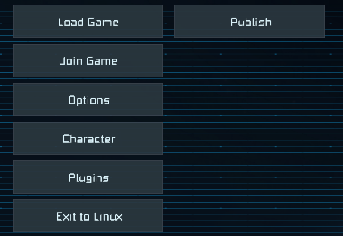
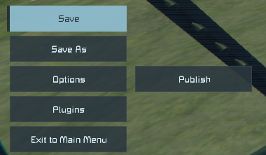
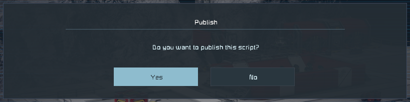
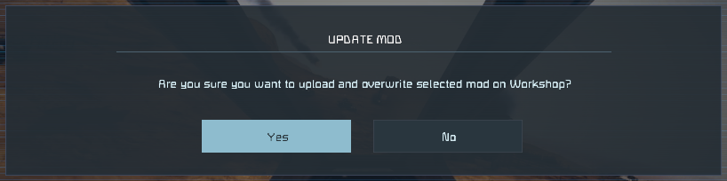
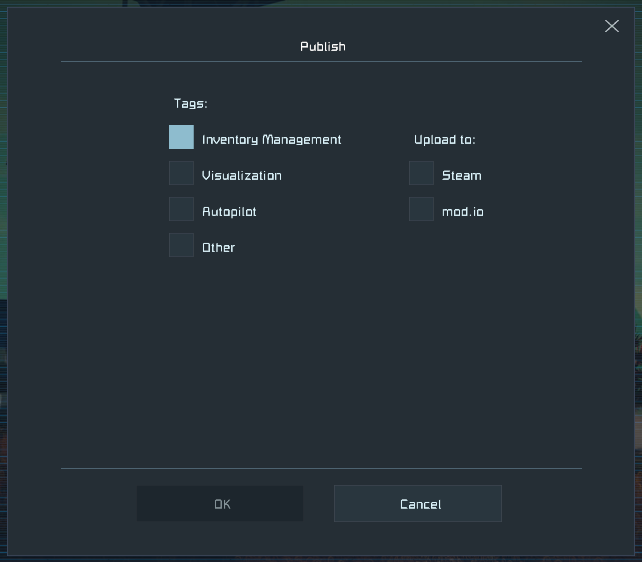

# Publishing scripts and mods to the Workshop

After changing a script or a mod, you can upload it straight from the main menu. There
is no need to dig through the Load Game screen or to open a programmable block in a
world.

## Opening the list

In the main menu, the **Publish** button is to the right of **Load Game**.

In a game, press Escape: the button is to the right of **Options**.

## The list

The list has your local scripts and mods:

- **Scripts** are the folders with a `Script.cs` in `%AppData%\SpaceEngineers\IngameScripts\local`,
  subfolders included. A script in a subfolder is shown with its path, for example
  `Tools/Door Controller`.
- **Mods** are the folders in `%AppData%\SpaceEngineers\Mods`, the same ones the game's
  Mods screen lists.

| Column | What it shows |
| --- | --- |
| Type | Script or Mod |
| Name | The folder name. Hover over it to see the full path. |
| Workshop ID | The item this folder is published as, empty if it isn't published yet |
| Visibility | Public, FriendsOnly, Private or Unlisted, as on the Workshop |
| Local change | When a file in the folder last changed |
| Published | When the item was last updated on the Workshop |
| Status | **Not published**, **Changed** (local changes since the last upload), **Up to date**, or **Unknown** when the time of the last upload isn't known |

Visibility and the Workshop's update time arrive a moment after the list opens. Until
then **Published** shows when the item was last published from this computer.

**Refresh** reads the folders and the Workshop details again. **Open in Workshop** opens
the selected item's Workshop page.

## Publishing an item

Select a script or a mod and press **Publish**. From here on these are the game's own
publish screens, the same ones the script browser and the Mods screen use.

1. The game asks whether you want to publish the script. For a mod it asks only when
   the mod is already on the Workshop, before overwriting it.

   

   

2. Pick the tags and where to upload (Steam, mod.io).

   

3. The game uploads the item and reports the result. On success it offers to open the
   item's Workshop page.

Only the owner of a mod can update it. For someone else's mod the game shows its usual
error and uploads nothing.

## Visibility of new items

A new item gets the visibility chosen under the list. It is **Private** by default, so
you can check the item on its Workshop page before anyone else sees it, then make it
public there. The game's own screens always publish new items as public.

An update keeps whatever visibility the item already has on the Workshop.

## Good to know

- Publishing needs the game to be connected to Steam (or mod.io). It does not work in
  offline mode.
- After an upload the game writes `modinfo.sbmi` into the folder. This file links the
  folder to its Workshop item. If you delete it, the next publish creates a new item
  instead of updating the old one.
- `modinfo.sbmi` and `metadata.mod`, which the upload itself writes, don't count as local
  changes.
- The game's own script browser misses the Workshop ID of a published script in a
  subfolder and would publish it as a new item. This list finds it.
