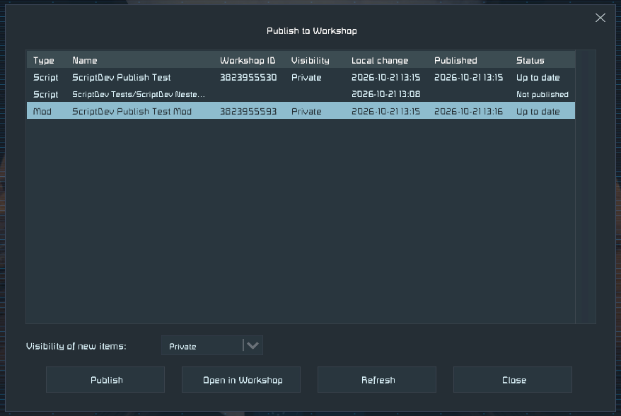

# ScriptDev Plugin for Space Engineers

Tools for programmable block script and mod developers:

- **Live script updates:** programmable blocks pick up the changes you save to their
  `Script.cs`, within a second.
- **Publishing:** a **Publish** button in the main menu lists your local scripts and mods,
  shows which ones changed since their last upload, and publishes them to the Workshop.

Please consider supporting my work on [Patreon](https://www.patreon.com/semods) or one time via [PayPal](https://www.paypal.com/paypalme/vferenczi/).

*Thank you and enjoy!*

## Prerequisites

- [Space Engineers](https://store.steampowered.com/app/244850/Space_Engineers/)
- [Pulsar](https://github.com/SpaceGT/Pulsar)

Enable the **ScriptDev** plugin in Pulsar and restart the game.

## Live script updates

Put the script's name in square brackets into the name of the programmable block,
for example `Programmable Block [Name Of My Script]`. For a script in a subfolder,
separate the folders by forward slashes: `Programmable Block [Script Subdir/Name Of My Script]`.

Scripts are under `%AppData%\SpaceEngineers\IngameScripts\local`. The plugin checks the
modification time of each `Script.cs` every second and loads the new code into the
blocks using it. Scripts longer than 100,000 characters load too, which is useful for
offline development but doesn't work in multiplayer.

- It works only in offline and locally hosted games.
- It isn't meant for a large number of programmable blocks.
- To pause it, untick **Enabled** in the plugin's settings. Changes saved meanwhile
  reach the blocks once you tick it again.

The [In-game Script Merge Tool](https://github.com/viktor-ferenczi/se-script-merge)
lets you write scripts in a proper IDE: merge a script from several files, share code
between scripts, keep unit tests out of the script and minify it for release.

## Publishing to the Workshop

The **Publish** button is to the right of **Load Game** in the main menu, and beside
**Load Game** in the in-game menu when In Game World Loading is enabled. Otherwise,
it appears beside **Options**.

Select a script or mod and press **Publish**. The upload goes through the game's own
publish screens. New items are **Private** by default, so you can check them before
making them public. Updates keep the visibility the item already has.

See [Publishing scripts and mods](Docs/Publishing.md) for the details.

## Development

The build finds the game through Steam. To override its location or set the deploy folders
below, use `Directory.Build.props.user`, which is not committed. `setup.py` creates it.

Load the working copy through a Pulsar development folder: start Pulsar with `-sources`,
then add this repository with the Sources button.

Builds deploy nothing by default. To deploy, set the target folder in
`Directory.Build.props.user` or pass it on the command line:

- `Pulsar`, for example `dotnet build -p:Pulsar=$HOME/.config/Pulsar`: the client plugin goes to
  `<Pulsar>/Legacy/Local/ScriptDev/` (net48) or `<Pulsar>/Interim/Local/ScriptDev/` (net10.0,
  falls back to `Legacy` if there is no `Interim` folder)
- `Torch`: the Torch plugin goes to `<Torch>/Plugins/ScriptDev/`, the Dedicated Server plugin
  to `<Torch>/DedicatedServer64/Plugins/`

The Torch and Dedicated Server projects are Windows only. They build against the `Torch`
folder link created by `Edit-and-run-before-opening-solution.bat`.

## Want to know more?

- [SE Mods Discord](https://discord.gg/PYPFPGf3Ca) FAQ, Troubleshooting, Support, Bug Reports, Discussion
- [Pulsar Discord](https://discord.gg/z8ZczP2YZY) Everything about plugins
